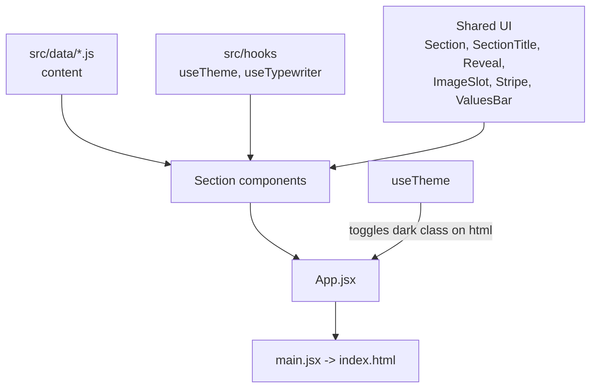

# Vivian Naliaka Mukhongo | Developer Portfolio

A responsive, animated developer portfolio built with **React**, **Vite** and **Tailwind CSS**. It showcases projects, skills, experience, certifications, community work and contact details, with a dark/light theme and smooth-scroll navigation.

Built for **Task 1: Personal Developer Portfolio & Project Showcase** of the Datheon internship.

- **Live site:** https://your-site.vercel.app
- **Author:** Vivian Naliaka Mukhongo, Software Engineer and Computer Science student, Chuka University, Kenya


## Features

- Mobile-first responsive layout using Flexbox and CSS Grid
- Dark/light theme toggle, saved in `localStorage` and defaulting to the system preference
- Smooth-scroll navigation with an active-section highlight and a scroll progress bar
- Mobile hamburger menu that closes after a link is selected
- Project showcase with category filters and a detail modal (closes with the X, the Escape key, or a backdrop click)
- Gallery carousel with arrows, dots, swipe support, autoplay (pauses on hover) and a lightbox
- Hero typing effect, scroll-reveal animations and count-up statistics
- Contact form that opens the visitor's email app, plus a floating WhatsApp button
- Respects `prefers-reduced-motion`
- Placeholder fallback for any image that is missing, which prints the file path it expected

## Tech stack

| Area | Tools |
|---|---|
| UI | React 19 |
| Build tool | Vite 8 |
| Styling | Tailwind CSS 4 (with `@tailwindcss/vite`) |
| Icons | lucide-react, react-icons |
| Font | Plus Jakarta Sans (Google Fonts) |
| Linting | oxlint |
| Hosting | Vercel |

## Getting started

### Prerequisites

- **Node.js 20.19+** (the current LTS is recommended)
- npm (included with Node.js)
- Git

### Installation

```bash
git clone https://github.com/<your-username>/vivian-portfolio.git
cd vivian-portfolio
npm install
```

### Run locally

```bash
npm run dev
```

Open the link Vite prints (usually `http://localhost:5173`).

### Other scripts

```bash
npm run build     # production build into /dist
npm run preview   # preview the production build locally
npm run lint      # run the linter
```

## Customising the content

All content lives in `src/data`, so you can update the site without touching the components.

| File | What it controls |
|---|---|
| `site.js` | Name, email, phone, social links, WhatsApp number, hero/about/skills/experience photos, navigation links |
| `projects.js` | Project cards, categories, tags, links and screenshots |
| `skills.js` | Skill groups and items |
| `experience.js` | Work experience and key highlights |
| `certifications.js` | Certificates and logos |
| `gallery.js` | Carousel photos and captions |

**Images:** place files in `public/images/` and reference them with a path that starts with `/images/`, for example `image: '/images/emab.jpg'`. File names are case-sensitive on the live site, so use lowercase.

**WhatsApp button:** set `whatsapp: '254712345678'` in `src/data/site.js` (country code, digits only). Until it is set, the button scrolls to the contact section.

## Architecture

The site is a single-page app. `App.jsx` stacks the sections in order, and each section is its own component that reads its content from a data file.



### Project structure

```
vivian-portfolio/
  public/
    images/              # photos, logos, screenshots
  src/
    components/
      Navbar.jsx         # sticky nav, active link, progress bar, mobile menu
      ThemeToggle.jsx
      Hero.jsx
      About.jsx
      Skills.jsx
      Projects.jsx       # filters + modal state
      ProjectCard.jsx
      ProjectModal.jsx
      Experience.jsx
      Certifications.jsx
      Gallery.jsx        # carousel + lightbox
      Community.jsx
      Contact.jsx
      Footer.jsx
      WhatsAppButton.jsx
      Section.jsx        # section wrapper (light/dark tone)
      SectionTitle.jsx
      Reveal.jsx         # scroll-reveal animation wrapper
      CountUp.jsx
      ImageSlot.jsx      # image with placeholder fallback
      Stripe.jsx
      ValuesBar.jsx
    data/                # all editable content
    hooks/
      useTheme.js
      useTypewriter.js
    App.jsx
    main.jsx
    index.css            # Tailwind import, brand colors, keyframes
  index.html
  vite.config.js
```

### Key design decisions

- **Data-driven components.** Content is separated from layout, so adding a project or certificate means editing one array.
- **Theme.** `useTheme` adds or removes a `dark` class on `<html>`. Tailwind's `dark:` variant is configured in `index.css` with `@custom-variant`.
- **Brand colors.** Black, red and green (taken from the Huduma Kenya Cyber logo) are defined once as theme tokens: `brand-black`, `brand-red`, `brand-green`.
- **Alternating sections.** `Section` takes a `tone` of `light` or `dark`, so the page alternates between white and black bands.
- **Animations.** `Reveal` uses `IntersectionObserver` to animate elements into view once. Keyframes (float, glow, fade-up) are defined in the Tailwind theme. A global `prefers-reduced-motion` rule turns motion off for users who ask for it.
- **Accessibility.** Semantic landmarks (`header`, `main`, `section`, `footer`), alt text and ARIA labels, keyboard-closable modal and lightbox, and visible focus states.

## Deployment

The site is deployed on **Vercel**.

1. Push the repository to GitHub.
2. In Vercel, choose **Add New → Project** and import the repository.
3. Use the detected Vite settings (build command `npm run build`, output directory `dist`).
4. Click **Deploy**. Every push to `main` redeploys automatically.

## Roadmap

- Django REST API with MySQL (separate repository) for managing projects, gallery and messages from an admin dashboard
- Contact form submissions saved to the database and emailed to the owner
- Blog and testimonials

## Contact

- Email: vivian.mukhongo@gmail.com
- LinkedIn: https://linkedin.com/in/viviannaliaka
- GitHub: https://github.com/vivianNova
## License

All rights reserved. The code is available for viewing as part of an internship submission. Photos, logos and written content belong to their respective owners.
